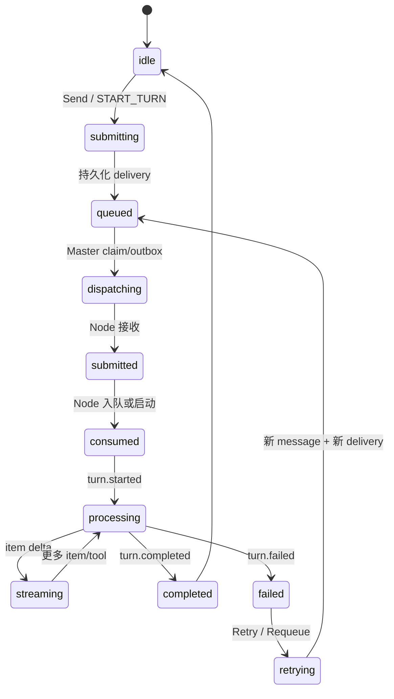
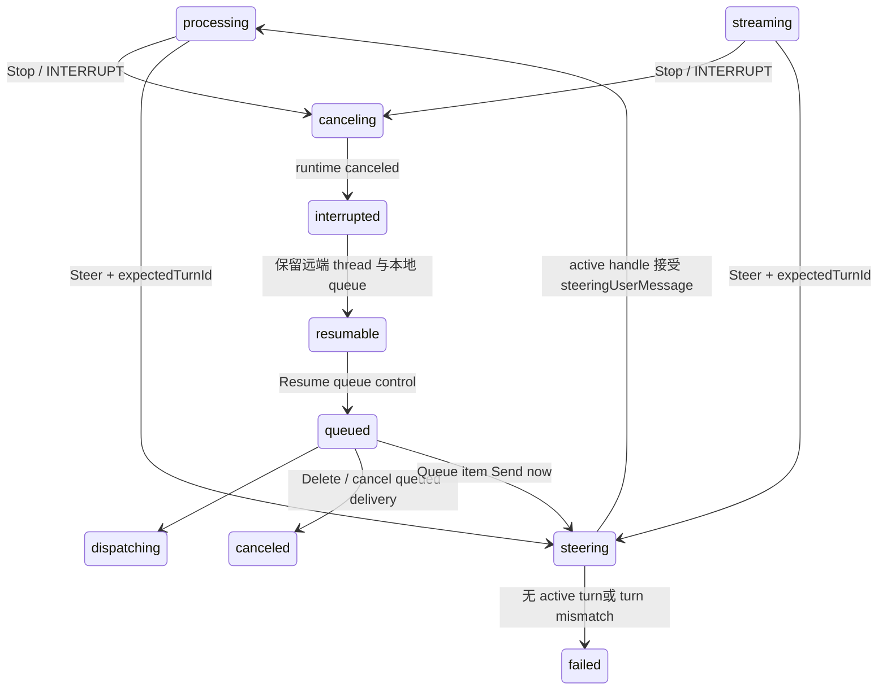
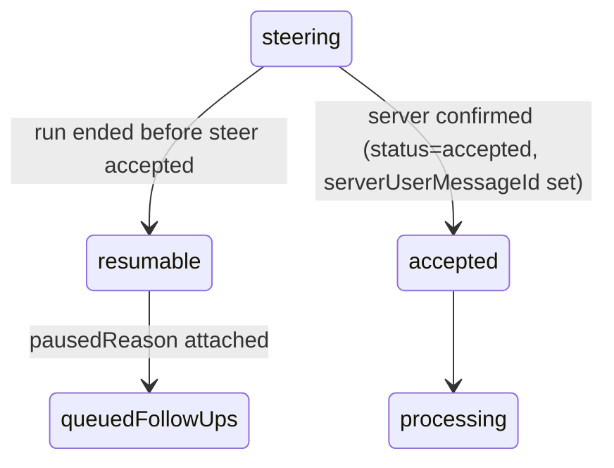

# 消息、投递与 Turn 状态机

## 三层模型

| 层       | 典型状态                                                                                                        | 责任                                           |
| -------- | --------------------------------------------------------------------------------------------------------------- | ---------------------------------------------- |
| message  | created、submitted、completed、failed、canceled                                                                 | 保存用户内容、client/server id 和幂等语义      |
| delivery | QUEUED、DISPATCHING、RETRY_WAIT、SUBMITTED、CONSUMED、RECEIVED、COMPLETED、FAILED、EXPIRED、CANCELED、CANCELING | 表示某条消息到目标 agent/thread 的权威投递状态 |
| turn     | idle、started、processing、streaming、completed、failed、interrupted                                            | 表示 Codex runtime 的一次模型运行              |

同一 message 可以有新的 delivery（Requeue），同一远端 thread 可以顺序运行多个 turn。不要把“队列项已删除”与“整个 thread 已删除”混为一谈。

## 主流程



## 中断、Resume 与 Steer



原生语义中，Steer 不会先把 active turn 变成 canceled；它在当前 turn 中追加 `steeringUserMessage`。如果产品实现选择 Stop + 新 turn，必须明确标记为不同语义，不能复用原生 tooltip 的 Steer 名称。

## Queue 暂停规则

```text
active turn --用户 Interrupt--> interrupted
interrupted + queue entries --> queue paused
queue paused --Resume--> queued/processing
queue paused --Delete--> remove one entry
queue paused --Retry/Edit--> replace or re-submit one entry
```

队列的权威列表来自 `ListQueue`/queue snapshot；UI 的 optimistic 行为必须在收到快照后校正。拖拽只改变队列顺序，不改变已经消费的 turn。

## 竞态保护字段

| 字段                                          | 用途                                                                    |
| --------------------------------------------- | ----------------------------------------------------------------------- |
| `expectedTurnId`                              | Steer/Cancel 只作用于用户看到的那一个 active turn；不匹配即拒绝         |
| `operationId`                                 | 将一次 Send/Steer/Interrupt/Resume 操作与异步 ack、日志关联             |
| `idempotencyKey`                              | 网络重试不创建重复 message；Resume 使用 `resume:{messageId}`            |
| `generation`                                  | cancel outbox 和 ack 的代际校验；旧取消不能影响 Requeue 后的新 delivery |
| `sequence`                                    | UI 事件排序和断线恢复后的去重                                           |
| `clientUserMessageId` / `serverUserMessageId` | transcript 去重及 steering 重复 user message 过滤                       |

## DeliveryMode 对照

仓库 proto 定义 `TAIL`、`NEXT_TURN`、`NEXT_ACTION`、`IMMEDIATE`、`CONTROL`：

- 普通用户 Send 默认 `TAIL`，当前 turn 结束后处理；
- Steer 固定 `IMMEDIATE` 并带 `InterruptActive = true` 的投递策略字段（runtime 层仍以 active handle 注入）；
- Node 的 Inject 支持 `QueueTail`、`QueueNextTurn`（提升优先级并请求中断）和 `QueueNextAction`（等 action boundary 后提升并中断）；
- `CONTROL` 用于中断/取消等控制路径，不应渲染成普通用户消息。

---

## 26.903 复核：协议层证据（2026-09-11）

上面的三层模型此前主要靠 UI 文案 + 仓库 proto 推断。本次在 `app.asar` 里找到了**原生 app-server JSON-RPC 方法表**（协议版本 `0.143.0-alpha.32`），可以直接对照，不再需要推断。完整方法清单见 [ipc-protocol.md](ipc-protocol.md) §2。

### 三层模型 ↔ 原生方法

| 层               | 本文的状态                                                             | 原生方法                                                                                                                                  |
| ---------------- | ---------------------------------------------------------------------- | ----------------------------------------------------------------------------------------------------------------------------------------- |
| turn             | idle → started → processing → streaming → completed/failed/interrupted | `turn/start` `turn/started` `turn/completed` `turn/interrupt` `turn/steer` `turn/diff/updated` `turn/plan/updated` `turn/settings/update` |
| turn 内的 item   | —                                                                      | `item/started` `item/completed` + 14 个 `item/<kind>/<event>` 流式通知                                                                    |
| delivery / queue | QUEUED → DISPATCHING → … → COMPLETED                                   | `thread/queue/list` `add` `update` `delete` `reorder` `start` `changed`                                                                   |
| thread           | —                                                                      | `thread/start` `resume` `stop` `fork` `revert` `rollback` `archive` `delete` `compact/start` …                                            |

**关键结论**：原生没有“delivery”这一层。它把「消息投递」直接建模为 **queue 条目**（`thread/queue/*`）+ **steer 条目**（`turn/steer` + item 里的 `steeringUserMessage`）。本文的 delivery 层是**本仓库 Master/Node 架构引入的抽象**，用于解决多节点、持久化、重试与幂等；原生是单进程 runtime，不需要它。

对照时不要把两者当成同构：

```
原生:  composer ──turn/start|turn/steer|thread/queue/add──▶ codex.exe (app-server)
仓库:  Renderer ──HTTP/WS──▶ Master ──delivery(outbox/generation)──▶ Node ──JSON-RPC──▶ codex.exe
                                    └── 权威 queue 快照 ListQueue ──┘
```

仓库的 delivery 层最终仍会落到原生的 `thread/queue/*` 或 `turn/steer`，所以**原生的语义约束是仓库必须遵守的下界**。

### Steer / Interrupt / Queue 是三条平行路径

```
turn/start       Send           无活动 turn 时开启新 turn
turn/steer       Steer          注入当前 turn，不打断模型
turn/interrupt   Stop           停止当前 turn
thread/queue/add Queue          排队到当前 turn 结束
```

修正本文「中断、Resume 与 Steer」图里的一处表述：`processing --> steering: Steer + expectedTurnId` 中，`expectedTurnId` 在原生侧对应的是 **`steeringUserMessage.targetTurnId` + `targetTurnStartedAtMs` 两个字段**，不是一个 id。双字段校验是为了防 turnId 复用。

### 竞态保护字段的原生对应

| 本文字段                                      | 原生对应                                               | 说明                                     |
| --------------------------------------------- | ------------------------------------------------------ | ---------------------------------------- |
| `expectedTurnId`                              | `targetTurnId` **+** `targetTurnStartedAtMs`           | 原生用双字段，更严格                     |
| `operationId`                                 | 无                                                     | 仓库为跨进程 ack 关联引入                |
| `idempotencyKey`                              | `clientUserMessageId`                                  | 原生用 client id 做 transcript 去重      |
| `generation`                                  | 无                                                     | 仓库为 cancel outbox 引入                |
| `sequence`                                    | `item/started`→`item/*Delta`→`item/completed` 的自然序 | 原生单连接有序，不需要显式序号           |
| `clientUserMessageId` / `serverUserMessageId` | **完全一致**                                           | `steeringUserMessage` 里就是这两个字段名 |

`compareKey = {rawText, imageCount}` 是原生的去重键，本文未记录；注意 `rawText` 会剥离图片占位与浏览器批注前言，与用户可见的 `displayRawText` 不同（详见 [conversation-behavior.md](conversation-behavior.md) 补充 3）。

### Queue 暂停规则的原生实现

本文的伪代码：

```
active turn --用户 Interrupt--> interrupted
interrupted + queue entries --> queue paused
```

原生对应的两条 `pausedReason` 常量：

```js
"Interrupted before the steer was accepted."; // turnStatus === "interrupted"
"Run ended before the steer was accepted."; // 其他终态（completed / failed）
```

即：**paused 不只发生在用户主动 interrupt 时**，turn 自然结束但 steer 未被接受也会 paused。本文的图需要补一条边：



### DeliveryMode 对照的修正

本文写「Steer 固定 `IMMEDIATE` 并带 `InterruptActive = true`」。原生侧**没有** `InterruptActive` 概念 —— `turn/steer` 本身就是不打断的注入。`InterruptActive` 是仓库 `api/proto` 的字段，属于实现选择。若要与原生语义严格对齐，Steer 路径不应触发任何 interrupt 行为。

`TAIL` / `NEXT_TURN` / `NEXT_ACTION` / `CONTROL` 四种模式在原生侧统一由 `thread/queue/add` + `thread/queue/reorder` 表达，优先级提升靠**重排**而非模式标记。

### 相关文档

- 协议方法全集：[ipc-protocol.md](ipc-protocol.md)
- steer 对账与降级代码：[conversation-behavior.md](conversation-behavior.md) 补充 1–3
- 渲染层 entry/turn 模型：[conversation-area.md](conversation-area.md)
- composer 三语义与队列 tray：[composer.md](composer.md) §3–4
